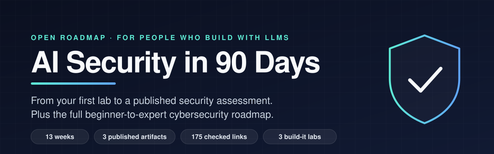
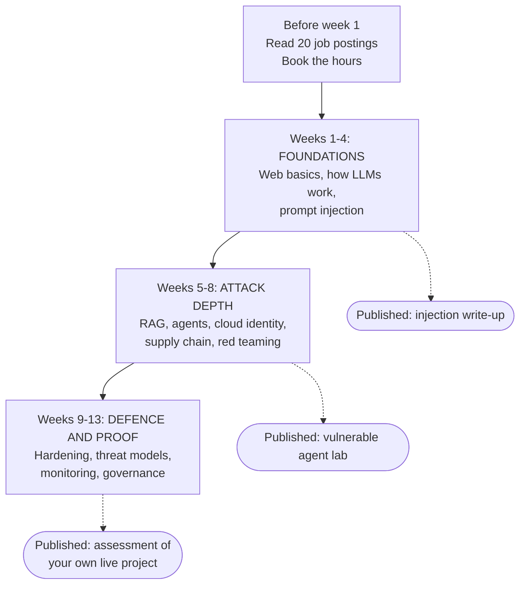
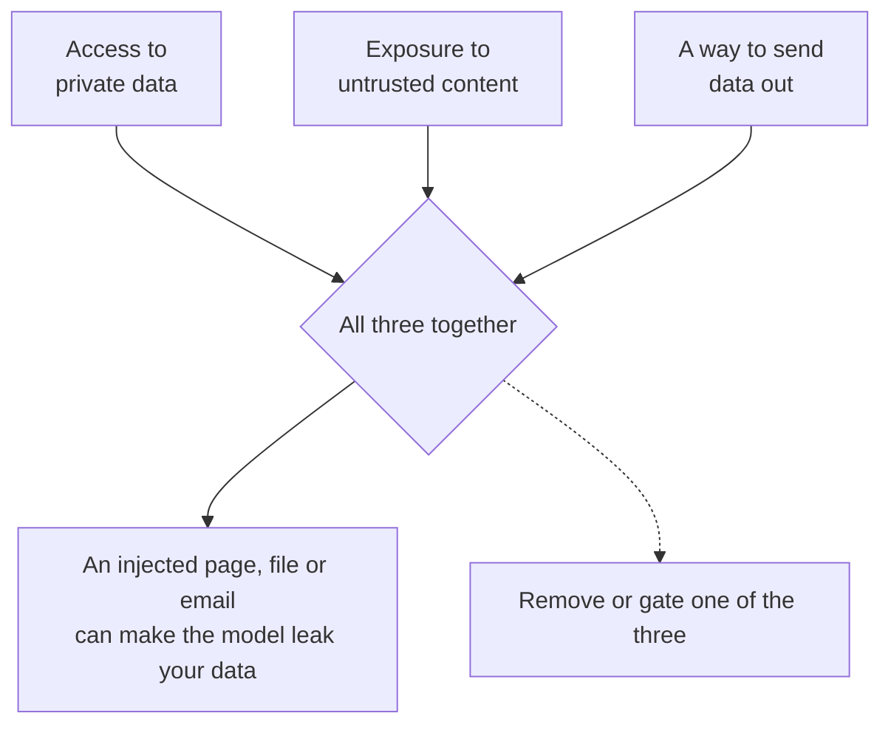

  

  
  
  
  

# AI Security in 90 Days

**You ship LLM features. Can you break them?**

Read it as a site, with search and navigation: **[aredwan-xyz.github.io/cybersec-roadmap](https://aredwan-xyz.github.io/cybersec-roadmap/)**

Most security roadmaps assume you want to become a SOC analyst or a penetration tester. This one is for people who already build with language models and want to learn how those systems fail, how to prove it in a lab, and how to fix it.

In 13 weeks, at about 10 hours a week, you build three small apps, break them, harden them, and publish three pieces of work. The full beginner-to-expert cybersecurity roadmap is here too, for everything that comes before and after.

> **The one rule.** Attack only systems you own, purpose-built labs, or bug bounty targets within their published scope. See [SECURITY.md](SECURITY.md).

## The 90 days

**[Start the plan →](ai-security-90-days/README.md)**

## Why prompt injection is not solved by a better prompt

A language model cannot reliably tell instructions from data. Anything it reads can steer it. An injection turns into data theft when three things are true at once:

Week 4 has you build this failure yourself, then fix it. That is the pattern for the whole plan: build it, break it, fix it, write it up.

## What is in the repo

| | What | Why it is useful |
|---|---|---|
| 🗓️ | [90-day AI security plan](ai-security-90-days/README.md) | Week by week: what to learn, what to build, what to publish. Includes exit criteria for when to stop |
| 🧭 | [Beginner-to-expert roadmap](ROADMAP.md) | Seven stages from first VM to expert, with checkpoints and the eight specializations compared |
| 📈 | [Market focus](market/focus-2026.md) | What employers are asking for, and the limits of that evidence |
| 🔗 | [Resource library](resources.md) | 175 links by stage and week, each one requested and checked |
| 🧪 | [Three build-it labs](labs/README.md) | Specs for a summarizer injection, a RAG access-control leak and an agent exfiltration. You write the code |
| ✅ | [Checklists](checklists/) | LLM app review, agent and tool security, AI supply chain, web app basics, home lab setup |
| 📝 | [Templates](templates/) | Threat model, findings report, AI security assessment, lab write-up, scope and authorization |
| ⚡ | [Cheatsheets](cheatsheets/) | LLM attack patterns, web vulnerabilities, networking, Linux |
| 📊 | [Progress tracker](PROGRESS.md) | Fork the repo and tick your way through |

## Start in five minutes

1. **Fork this repo** so the progress tracker and notes are yours.
2. Open the [90-day plan](ai-security-90-days/README.md) and do "Before week 1". It asks you to read 20 real job postings before you commit. Use [the template](templates/job-posting-review.md).
3. Play [Gandalf](https://gandalf.lakera.ai) for 20 minutes. If you enjoy it, this field may suit you.
4. Start week 1 and tick it off in [PROGRESS.md](PROGRESS.md).

Not a builder yet? Start with [ROADMAP.md](ROADMAP.md), stage 0, and come back to the 90-day plan after stage 2.

## The whole road

**Setup → IT foundations → Security fundamentals → Hands-on core → Specialize → Professional depth → Expert**

Job-ready in one track takes about 12 to 18 months of steady work. "Expert" takes about five years of real work. [The roadmap](ROADMAP.md) says so plainly and tells you what each stage should let you do.

## What makes this one different

- **It is for builders.** It starts from "you can already ship an app" and adds security, instead of starting you over as a junior analyst.
- **Every phase ends in public work.** Three published artifacts in 90 days, not a certificate.
- **It tells you when to quit.** The plan has exit criteria, and asks you to check the direction against real job postings first.
- **It says what it does not know.** See [the limits](docs/limitations.md): where the evidence is thin and what has not been validated.
- **The links work.** A scheduled check requests every link in the repo.

## Honest limits

- The labs are specifications. There is no lab code here; writing it is the exercise.
- The market section rests on skills surveys, not a count of real job postings.
- 90 days makes you useful on your own systems. It does not make you a penetration tester.
- Descriptions of third-party courses and their prices may be out of date. The link check proves a page loads, nothing more.

More in [docs/limitations.md](docs/limitations.md).

## Contributing

Corrections, dead links, better resources and lab solutions are welcome. Read [CONTRIBUTING.md](CONTRIBUTING.md) first. The short version: one change per pull request, say why a resource earns its place, and never add anything that targets systems without permission.

If this helped you, a star helps other builders find it.

## License

Written content: CC BY 4.0. Code under `labs/`: MIT. See [LICENSE.md](LICENSE.md).
